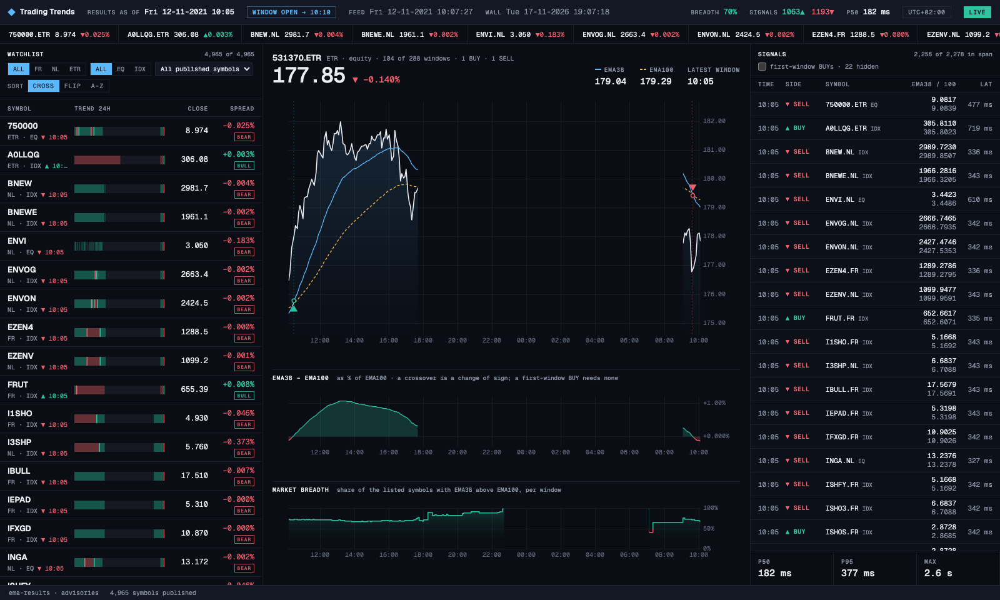
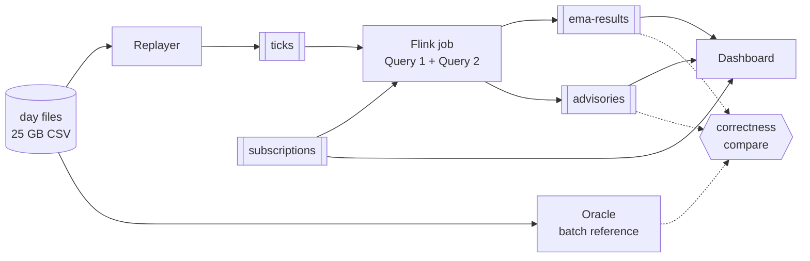

<div align="center">

# Detecting trading trends in financial tick data

**EMA crossovers over a week of real European market data, streamed through Kafka and Apache Flink.**

[](https://flink.apache.org/) [](https://kafka.apache.org/) [](https://openjdk.org/projects/jdk/17/) [](https://react.dev/) [](https://www.python.org/) [](https://doi.org/10.5281/zenodo.6382482)
[](https://github.com/eemelioksanen/scalable-systems-and-data-management/stargazers) [](https://github.com/eemelioksanen/scalable-systems-and-data-management/commits/main) [](https://github.com/eemelioksanen/scalable-systems-and-data-management/pulse) [](https://github.com/eemelioksanen/scalable-systems-and-data-management)
     

[Run it](#run-it-end-to-end) · [The stack](#the-stack) · [Dashboard](#dashboard) · [Tests](#tests) · [Correctness](#correctness-check) · [Benchmarks](#benchmarks) · [Decisions](docs/decisions.md) · [By the numbers](#by-the-numbers)



</div>

<br>

Built for the CS-E4780 Scalable Systems and Data Management course project (Aalto, 2026). It runs two queries over the [DEBS 2022 Grand Challenge trading data](https://doi.org/10.5281/zenodo.6382482), 289 million rows from 8 to 14 November 2021:

| | Query | Output topic |
|---|---|---|
| **1** | EMA₃₈ and EMA₁₀₀ per symbol over 5-minute tumbling windows | `ema-results` |
| **2** | A BUY or SELL advisory when the two EMAs cross | `advisories` |

A dashboard shows both live, as a trading terminal. The task is in [CS_E4780_Course_Project_2026.pdf](CS_E4780_Course_Project_2026.pdf), and every design choice is logged with its reasons in [docs/decisions.md](docs/decisions.md), where the text refers to it as D-n.

## How it fits together



The replayer sends the CSV rows to the Kafka topic `ticks`, at full speed or paced against the source clock.
The Flink job computes both queries for every symbol but publishes only the symbols some trader subscribes to in `subscriptions`.
The dashboard reads what the job publishes and recomputes nothing.
An independent batch oracle computes the same queries, and the correctness tools compare the job's output with it.

<details>
<summary>What each directory holds</summary>

| Directory | What it holds |
|---|---|
| `producer/` | The replayer ([docs/replayer.md](docs/replayer.md)) |
| `flink-job/` | Query 1 and Query 2 |
| `viz/` | The dashboard: a Java backend and a React frontend ([viz/README.md](viz/README.md)) |
| `oracle/` | The batch reference implementation ([oracle/README.md](oracle/README.md)) |
| `correctness/` | Export, compare and late-event injection tools ([correctness/README.md](correctness/README.md)) |
| `bench/` | The benchmark harness ([bench/README.md](bench/README.md)) |
| `analysis/` | The dataset profile and the data contract it justifies ([analysis/README.md](analysis/README.md)) |
| `infra/` | Kafka and Prometheus configuration |
| `docs/` | Decisions, interfaces, the roadmap, the analysis reports and the recorded validation runs |

</details>

## Requirements

Docker, or Podman with its Compose provider. No JDK, Maven or Node is needed on the host: every build runs in a container.

| Resource | Needed for |
|---|---|
| ~25 GB disk | The seven day files; `fetch_day.py` also wants 20 GiB free beyond what is left to download |
| ~5 GB in Docker's storage | A full week in Kafka, compressed with lz4 |
| 8 GiB Docker VM | Up to two TaskManagers |

> [!TIP]
> Under rootless Podman, cAdvisor cannot mount `/var/lib/docker`. Start the other services by name, as step 2 shows, and Prometheus goes without the per-container metrics.

## Run it end to end

### 1 · Get the data

Download the seven day files from Zenodo into `data/daily/`, which is gitignored. `fetch_day.py` resumes interrupted transfers and checks the published MD5.

```bash
for day in 08 09 10 11 12 13 14; do python3 analysis/src/fetch_day.py 2021-11-$day; done
```

### 2 · Start the stack

This builds the images, starts Kafka, Flink, Prometheus and the dashboard, and creates the topics. The replayer is built separately.

```bash
docker compose up -d --build
docker compose build producer

# Rootless Podman: name the services, leaving out cAdvisor
docker compose up -d --build kafka kafka-init jobmanager taskmanager prometheus viz
```

### 3 · Subscribe

> [!IMPORTANT]
> Write the subscriptions before submitting the job. It holds its results back until it has read the subscriptions that existed at submission.

This subscribes one trader to every symbol:

```bash
echo 'all|{"trader":"all","symbols":["*"]}' | docker compose exec -T kafka /opt/kafka/bin/kafka-console-producer.sh --bootstrap-server kafka:9092 --topic subscriptions --reader-property parse.key=true --reader-property key.separator='|'
```

### 4 · Submit the job

The jar is baked into the image, so rebuild with `docker compose up -d --build` after a code change.

```bash
docker compose exec jobmanager flink run -d -c fi.aalto.cse4780.trading.TradingTrendsJob /opt/job/flink-job.jar
```

### 5 · Replay the week

> [!WARNING]
> Start within 30 s of submitting a live job, or its idleness timeout rejects the first rows as late.

This sends Monday to Thursday at full speed, then plays Friday at 120 times real time so the dashboard has something to show:

```bash
mkdir -p bench/results/raw
docker compose run --rm -T producer fi.aalto.cse4780.replay.Replayer --input /data/daily \
  --mode realtime --rate 120 --pace-from 2021-11-12T09:00 > bench/results/raw/replay.json
```

### 6 · Watch

Open the dashboard at http://localhost:8088.

On a laptop the unpaced part runs at about 1.3 million rows a second, and the whole replay, weekend included, takes about half an hour.

> [!NOTE]
> Each symbol's first window gives a BUY because both EMAs start at 0 (D-7), so Monday shows almost no real crossovers. They start on Tuesday. The dashboard hides those first-window BUYs unless you ask for them.

| UI | URL |
|---|---|
| Dashboard | http://localhost:8088 |
| Flink | http://localhost:8081 |
| Prometheus | http://localhost:9090 |
| Kafka from the host | `localhost:29092` |

## The stack

<details>
<summary>Stop, reset, scale, ports and project names</summary>

Stop and resume the same containers, keeping Kafka's data:

```bash
docker compose stop
docker compose start
```

Reset it, removing the containers and their data:

```bash
docker compose down --volumes
docker compose up -d --build
```

Kafka has no persistent volume. `stop` keeps its data in the container. `down`, with or without `--volumes`, removes the container and with it the topics, records, subscriptions and consumer offsets. On the next start, `kafka-init` creates the six application topics again, empty. `--volumes` also removes the anonymous volumes of the monitoring images.

Scale Flink out to two TaskManagers, four slots with the defaults:

```bash
docker compose up -d --scale taskmanager=2
```

`TICKS_PARTITIONS` defaults to 8, `TM_SLOTS` to 2 and `PARALLELISM` to 2. Changing the partition count does not resize existing topics, so reset the stack to apply it. More TaskManagers need more Docker memory; the two-TaskManager check was designed for an 8 GiB Docker VM.

`KAFKA_HOST_PORT`, `FLINK_HOST_PORT`, `PROMETHEUS_HOST_PORT` and `VIZ_HOST_PORT` change the host ports. Kafka advertises the chosen host port, and clients inside Compose use `kafka:9092`. Every worktree uses the Compose project name `trading-trends`, so run a second stack with `docker compose -p <project>`, which also gives it its own image tags.

</details>

### Job options

<details>
<summary>Bounded and live modes, zone offset, watermark and idleness</summary>

| Option | Default | Meaning |
|---|---|---|
| `--bounded` | off | Read the `ticks` and `subscriptions` offsets that exist at startup, evaluate every window including the last, and finish. |
| `--zone-offset` | `+02:00` | The UTC offset of the trading timestamps, the literal CEST of D-3. |
| `--watermark-bound-ms` | 1,000 live, 64,265,001 bounded | How long event time waits for out-of-order events (D-38). |
| `--idleness-ms` | 30,000 live, 0 bounded | After how long without a price event a partition counts as idle; 0 turns it off. |
| `--checkpoint-interval-ms` | 0 | Checkpoint every this many milliseconds; 0 turns checkpointing off. See [restart and replay](docs/interfaces.md#restart-and-replay-d-28). |

A live job rejects Wednesday's 5,506 burst rows at 01:00 as late. The bounded defaults admit them, so a `--bounded` run meets the admit-all correctness target of D-30 ([full-week analysis](docs/eda-week.md#watermarks-and-downstream-effects)). [docs/interfaces.md](docs/interfaces.md#event-time-late-events-and-end-of-input-d-5-d-38) explains both modes, and [the subscriptions section](docs/interfaces.md#subscriptions-d-17) covers the format, when a change takes effect and how to rerun.

The design comparisons of the roadmap are switches of the job and the replayer: the Window API instead of the process function, early filtering, RocksDB, binary `ticks` and carry-forward of empty windows (D-42). Each default is the baseline.

</details>

### Replayer options

<details>
<summary>Modes, pacing, subsets and the replay report</summary>

The producer is in the Compose `tools` profile, so the default start command does not build it. Its image holds the replayer at `/app/producer.jar`, and Compose mounts `data/` read-only at `/data`. A directory given to `--input` replays its day files in the calendar order of their names.

`--mode preload` (the default) loads the input as fast as Kafka takes it, `--mode realtime --rate K` paces it at K times real time, and `--pace-from T` sends everything before source time T unpaced. `--exchanges`, `--symbols` and `--limit` select a subset. The JSON report on stdout says whether the replay completed and which offsets it wrote, and progress goes to stderr. [docs/replayer.md](docs/replayer.md) covers the modes, the report, how to verify a replay against Kafka and the source files, and how to reset `ticks`.

</details>

### Metrics

<details>
<summary>What Prometheus scrapes, and where the queries are</summary>

Prometheus scrapes the job's counts, the Kafka broker through a JMX exporter agent, and cAdvisor for CPU, memory and network per container and for the Docker host. [docs/interfaces.md](docs/interfaces.md#metrics-d-35) gives the query for each measurement, and [the counts section](docs/interfaces.md#counts-d-28) lists what the job counts. The parser's counts are under `flink_taskmanager_job_task_operator_deserializer_ticks_*`, the rest under `flink_taskmanager_job_task_operator_*`.

</details>

## Dashboard

The dashboard is a dark trading terminal over `ema-results` and `advisories` (D-33, D-41, D-43):

- a watchlist of every published symbol with its 24-hour trend, newest close and EMA spread, sorted by latest crossover
- the selected symbol's close, EMA38 and EMA100 with ▲ BUY and ▼ SELL markers, the EMA spread whose sign changes are the crossovers, and the market's breadth
- the advisories as they are published, with their latency
- a clock bar with the results' time, the feed time and wall-clock time

Filters by exchange, SecType and subscription apply to the watchlist and the advisories, and they live in the URL, so a view can be linked. `curl -s localhost:8088/health` reports what the backend has read, the symbols and sessions it holds, and both clock values. Operational metrics stay in Prometheus.

[viz/README.md](viz/README.md) covers its options, the WebSocket protocol, frontend development, and the scripted end-to-end check that replays two days, changes subscriptions mid-run and compares what the dashboard shows with the topics and the oracle ([recorded run](docs/validation/2026-11-10-dashboard/README.md)).

## Tests

Run the Maven tests in a container with a cached dependency volume, the fastest loop for day-to-day work:

```bash
scripts/mvn.sh test
```

The Docker test target runs Maven `clean verify`, including the Flink mini-cluster tests, and the dashboard's frontend tests:

```bash
docker build --target test --no-cache-filter test .
```

## Correctness check

The correctness check compares a finished run with the oracle (D-18). Run the oracle over the same day files, then export and compare a `--bounded` run with the `["*"]` subscription:

```bash
oracle/run.sh data/daily/debs2022-gc-trading-day-*.csv     # results in oracle/out/
correctness/run.sh export --zone-offset +02:00 --out /out/run-1
correctness/run.sh compare --oracle oracle/out --job correctness/out/run-1 --job-late-ticks 0 --out /out/run-1-vs-oracle
```

`correctness/run.sh inject` rewrites day files with bounded disorder and late events. [The weekday evidence](docs/validation/2026-10-13-weekday/README.md) runs this check for every symbol of 8 November, at both modes' watermark defaults, at replay speeds from 10× to a preload, and on reordered input (D-39). [The full-week evidence](docs/validation/2026-11-01-full-week/README.md) does it for the whole week.

## Benchmarks

`bench/run.py` resets the stack, replays an input, runs the job to completion and keeps the raw measurements, the effective configuration, a count reconciliation and, given an oracle run, the correctness check. `bench/summarize.py` turns repeated runs into CSV tables and plots with mean and standard deviation. A config's `variant` picks a design comparison ([bench/README.md](bench/README.md#variants-d-42)).

```bash
python3 bench/run.py bench/configs/subset12-preload-p2.json
bench/.venv/bin/python bench/summarize.py bench/results/raw/subset12-preload-p2-<stamp>
```

## Verify the local stack

<details>
<summary>What the script checks, and how to run it</summary>

`scripts/verify-local-stack.py` builds the images, runs the containerized Maven target, tests both Kafka connection paths, runs a bounded Flink and Kafka roundtrip, checks the slots before and after scaling, and queries real Flink, Kafka and cAdvisor metrics through Prometheus. It also proves that stop and start keep Kafka's records and a reset removes them. It uses its own Compose project, free host ports and synthetic topics, then removes its containers and images. Base images and build caches stay for later runs.

It needs Python 3.9 or later and one Python Kafka client:

```bash
python3 -m venv .venv
.venv/bin/python -m pip install -r scripts/validation/requirements.txt
.venv/bin/python scripts/verify-local-stack.py
```

Each run prints its evidence directory, with `commands.log`, `results.json` and metric samples; `--output <new-directory>` picks it. A failed check exits nonzero and keeps its evidence. [docs/local-stack-validation.md](docs/local-stack-validation.md) records the observed results and limits.

</details>

## Dev container

<details>
<summary>Using the dev container, and checking it in the stack verification</summary>

Open the repository with your IDE's dev-container support and run `mvn -B -ntp clean verify` in its terminal. JDK 17, Maven, Python and the Docker CLI run inside the container. Run the Compose commands from a host terminal, so their bind-mount paths refer to the host workspace.

To check the dev container in the stack verification too, install the reference CLI, which needs Node.js and pnpm on the host:

```bash
validation_cli_dir=$(mktemp -d)
pnpm --dir "$validation_cli_dir" add @devcontainers/cli@0.89.0
.venv/bin/python scripts/verify-local-stack.py --devcontainer "$validation_cli_dir/node_modules/.bin/devcontainer"
```

This builds `.devcontainer/devcontainer.json`, runs Maven `clean verify` inside it, and checks that it reaches the host's Docker daemon and Compose. Without the flag, the run records that the dev container was not checked.

</details>

## Dataset profile

<details>
<summary>How the dataset was profiled, and what the analysis containers may touch</summary>

The dataset is CC BY-NC-SA 4.0 and is never committed. [docs/data-contract.md](docs/data-contract.md) holds the measured facts the queries rely on, [docs/eda-monday.md](docs/eda-monday.md) the Monday profile and [docs/eda-week.md](docs/eda-week.md) the full week. [analysis/README.md](analysis/README.md) explains how they are produced:

```bash
bash analysis/daily.sh 2021-11-08                # one day's tables and figures
analysis/src/fetch_slice.sh                      # a ~1 GB stratified sample into data/slice
analysis/run.sh analysis/src/profile.py          # evidence tables into analysis/out/
analysis/run.sh analysis/src/golden.py           # golden fixtures into fixtures/golden/
```

`daily.sh` verifies the download, resumes from the day's parsed checkpoint, and regenerates its tables and figures in a 4 GiB container. `run.sh` uses the container in `analysis/Dockerfile`, which is what the report cites. `USE_VENV=1` runs the same scripts in a local virtualenv, which is faster for iteration because bind mounts on macOS are slow for multi-GB scans. Both produce the same output.

The analysis container runs read-only, with `--network none`, `--cap-drop ALL` and `no-new-privileges`, and mounts the input data read-only. `run.sh` can write only `analysis/out/` and `fixtures/`, and `daily.sh` and `week.sh` write their output under `analysis/out/` and their cache in `data/analysis/`. Only `fetch_slice.sh` and `fetch_day.py` use the network, and both run on the host.

### Container file access

Containers read host files only where a bind mount grants it, and every mount in this repository is a project-relative path except cAdvisor's. cAdvisor runs privileged and mounts the Docker host's `/`, `/sys`, `/var/run` and `/var/lib/docker` read-only. To enforce the rest instead of relying on convention, restrict Docker Desktop's shared paths (Settings, Resources, File sharing) to this repository. The defaults include `/Users`, so without that change a bind mount anywhere in your home directory is allowed.

</details>

## By the numbers

| Number | What it counts |
|---:|---|
| **289,116,808** | rows in the week's seven day files |
| **49.5%** | of those rows have an empty payload |
| **20.5%** | carry a price the queries use |
| **5,502** | symbols, of which 532 never trade all week |
| **11,355** | advisories in the week |
| **4,970** | of them are first-window BUYs, because EMA₀ = 0 (D-7) |
| **5,506** | Wednesday rows that arrive at 01:00 and a live job rejects as late |
| **64,265,001 ms** | the bounded watermark that admits them, about 17.9 hours |
| **1.3 M rows/s** | replay speed into Kafka on a laptop |
| **27.7 min** | to replay the whole week, Friday paced at 120× |
| **849** | mentions of "watermark" in this repository |
| **44** | numbered design decisions |
| **101** | commits and **27** merged pull requests, since 28 September 2026 |
| **9,415 / 8,148 / 1,601** | lines of Java, Python and JavaScript |
| **4,395** | lines of Markdown |

## Star history

<a href="https://star-history.com/#eemelioksanen/scalable-systems-and-data-management&Date">
  
</a>

## Contributors

<a href="https://github.com/eemelioksanen/scalable-systems-and-data-management/graphs/contributors">
  
</a>

## Further reading

| Document | What it covers |
|---|---|
| [docs/ROADMAP.md](docs/ROADMAP.md) | The plan and its status |
| [docs/decisions.md](docs/decisions.md) | Every design decision, with its alternatives and evidence |
| [docs/interfaces.md](docs/interfaces.md) | Topic formats, counts, metrics and the oracle comparison |
| [docs/replayer.md](docs/replayer.md) | Replay modes, the report, disk use and throughput |
| [docs/validation/](docs/validation/) | The recorded validation runs |

<div align="center"><sub>The DEBS 2022 Grand Challenge data is CC BY-NC-SA 4.0 and is never committed to this repository.</sub><br><br><a href="#readme">Back to top</a></div>
