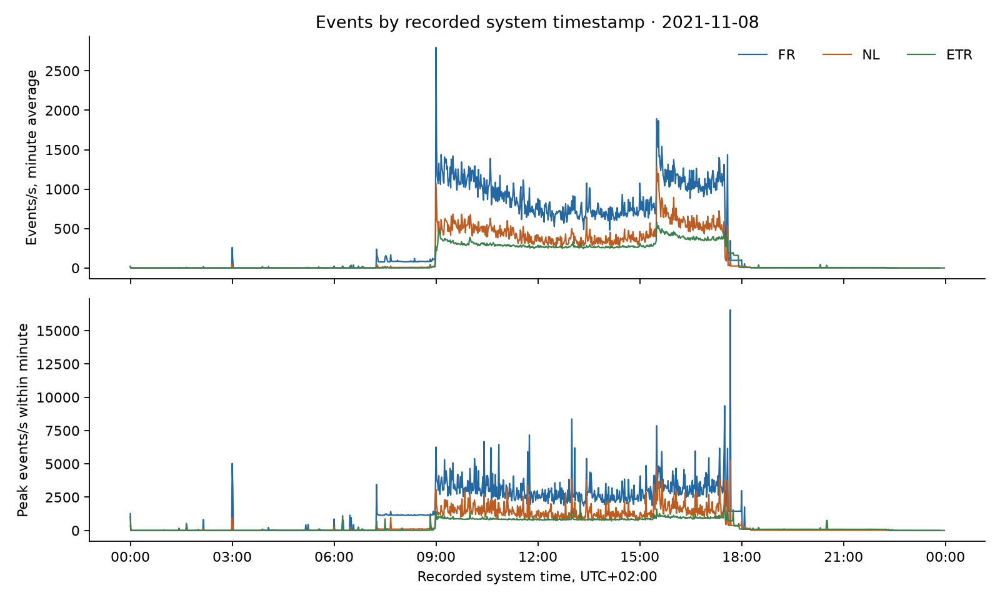
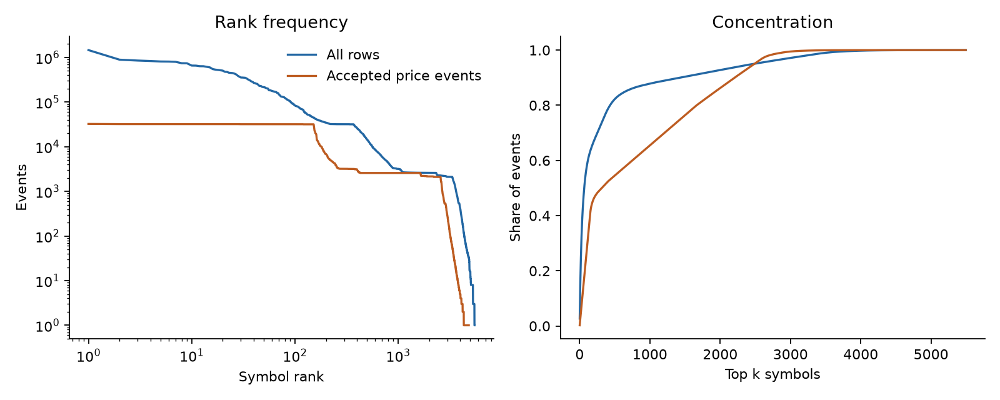
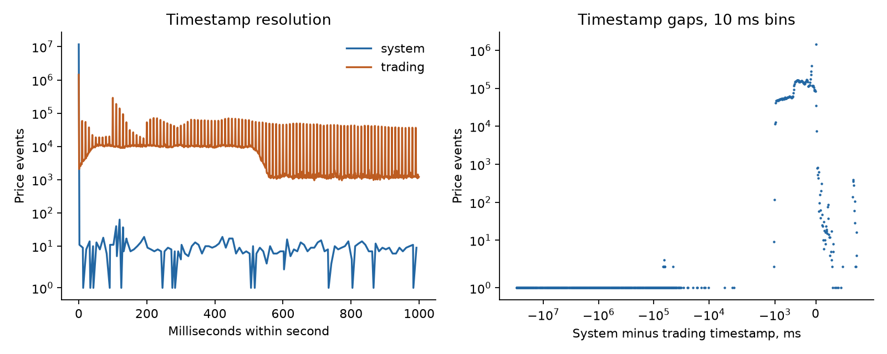

# Monday dataset analysis

This is the historical first-day checkpoint. The subsequent [full-week analysis](eda-week.md) covers the remaining files and continuous week.

The complete 8 November 2021 file contains **53,994,554 data rows**, including **11,794,520 accepted price events** and **373,126 nonempty five-minute windows**.
All three counts match the independently implemented oracle's [weekday evidence](../oracle/evidence/2026-09-28-weekday-08-11-21.json).
The input's MD5 matches Zenodo, `a08013f09a6b77355dae8b3ce141624d`.
This is the agreed first-day checkpoint for [issue #4](https://github.com/eemelioksanen/scalable-systems-and-data-management/issues/4); the remaining six days have not been downloaded or analyzed by this pipeline.

Run `bash analysis/daily.sh 2021-11-08` to reproduce it.
The [method](../analysis/README.md) defines classification, denominators, partitioning and watermark limitations.
The [completion manifest](../analysis/out/daily/2021-11-08/manifest.json) records input identity, code and output hashes, dependency versions, time and memory.
The run uses a network-disabled container with a 4 GiB memory limit.
The final fresh analysis took 104.5 seconds and peaked at 2.68 GiB process RSS; parsing took 60.9 seconds and peaked at 0.53 GiB.
These timings exclude download verification and image build time.
All 38 generated tables and figures are byte-identical to the preceding bounded-batch run.
Eight focused tests pass, including Kafka hash compatibility, source positions across batch boundaries, timestamp policy, watermark boundaries, download recovery and summary denominators.
A separate checkpoint-reuse check preserved the original parsing metrics without rewriting the checkpoint.

## Event mix and reconciliation

| Class | Rows | Share |
|---|---:|---:|
| Empty payload | 25,980,851 | 48.12% |
| Quote | 15,044,716 | 27.86% |
| Positive `Last` | 11,794,520 | 21.84% |
| Other populated payload | 1,112,255 | 2.06% |
| Zero `Last` | 62,212 | 0.12% |

There are also 12 comment lines and one header.
No malformed rows, malformed prices or negative prices occur.
All positive-price timestamps parse under the selected date fallback.
The taxonomy checks all payload fields; the earlier sample's selected-field definition could call metadata an empty payload, so the class shares are not directly comparable.
See [row reconciliation](../analysis/out/daily/2021-11-08/row_reconciliation.csv), [taxonomy by exchange and security type](../analysis/out/daily/2021-11-08/taxonomy.csv), and [timestamp quality](../analysis/out/daily/2021-11-08/quality.csv).

Raw replay throughput includes every data row, while only 21.84% reach price-window processing.
Monday is only part of the published 289 million-event week; no full-week discrepancy can be inferred from its count.
The teammate's completed oracle gives the more precise full-week count of 289,116,808, which reconciles the published rounded total.

## Rates

| Exchange | Peak events/s | p99 events/s |
|---|---:|---:|
| All combined | 22,537 | 4,317 |
| FR | 16,560 | 2,579 |
| NL | 5,245 | 1,250 |
| ETR | 2,386 | 805 |

These are counts by recorded system timestamp, not measured network ingestion rates.
Each p99 includes zero-event seconds throughout that exchange's first-to-last observed timestamp interval.
The combined interval contains 86,334 seconds, of which 42,929 have no events.
Exactly 11,999 data rows lack a usable system timestamp and are excluded from rate bins: 11,996 other metadata rows and three empty-payload rows.
The binned total of 53,982,555 plus those rows reconciles to the file total.

The main activity step is around recorded 09:00; a later burst appears near 15:30, followed by sharp end-of-session spikes around 17:30–17:40.
FR's largest second is 17:40:00 at 16,560 events.
These are observed shapes, not claims about an official exchange calendar or its timezone conversion.
Times here use the selected literal CEST offset, UTC+2.

The [rate summary](../analysis/out/daily/2021-11-08/rates_summary.csv), [trading-clock rate summary](../analysis/out/daily/2021-11-08/trading_rates_summary.csv), [peak seconds](../analysis/out/daily/2021-11-08/peak_seconds.csv), [system-time minute counts](../analysis/out/daily/2021-11-08/rates_minute.csv) and [trading-time minute counts](../analysis/out/daily/2021-11-08/trading_rates_minute.csv) retain the numbers behind this distinction.
The [activity-band table](../analysis/out/daily/2021-11-08/activity_spikes.csv) quantifies recorded 07:00–10:00 and 16:00–19:00 peaks per exchange. These are analysis bands, not official session hours.
Detailed per-second data remains in the ignored checkpoint directory.
For later replay experiments, the [offered-load targets](../analysis/out/daily/2021-11-08/replay_targets.csv) use Monday's 4,317 events/s p99 and 22,537 events/s observed peak at multipliers 1×, 10× and 100×.
Those are offered-load targets; whether the system sustains them remains a benchmark question.

## Skew and empty windows

Monday contains 5,493 symbols, of which 653 have no price events.
The top 100 symbols account for 57.61% of raw rows but 27.09% of accepted price events.
Gini is 0.8543 for raw events and 0.7126 for accepted price events, including zero-price symbols in the population.
At eight Kafka partitions, the busiest partition receives 1.2705 times the mean raw load and 1.1647 times the mean price-event load.
Kafka load and downstream price-processing load therefore need separate measurements.

The [partition table](../analysis/out/daily/2021-11-08/partition_load.csv) covers 1, 2, 4, 8, 16 and 32 partitions using Kafka's actual UTF-8 key hash rule.
It describes Kafka partition load, not Flink key-group assignment or state size.

Across all observed symbols, 76.20% of symbol/windows are empty within the exchange's observed system-time span.
Across the full local calendar day, the share is 76.41%.
The small difference reflects how metadata extends the observed exchange span across nearly the whole day; it does not establish official session hours.
The [per-symbol table](../analysis/out/daily/2021-11-08/window_statistics.csv) states both denominators and nonempty-window event quantiles.
The [window-density figure](../analysis/out/daily/2021-11-08/window_density.png) shows the distribution.
These figures describe sparsity; the selected skip-empty-window rule is a semantic choice, not something the data proves uniquely correct.

## Timestamp quality and watermark experiments

System `Date` supplies 10,873,721 missing trading dates, exactly matching the oracle.
No positive-price row lacks trading time, has an unparseable event timestamp, or supplies a date that differs from system date.
This supports the fallback for Monday, without asserting that date mismatches cannot occur elsewhere.

Among price events, 99.9905% of system timestamps fall on whole seconds, while 87.4253% precede their trading timestamp.
Whole-second system resolution is consistent with much of the subsecond negative-gap pattern, but it does not establish how the producer rounded or captured timestamps.
There are also **944 price rows** with system time more than two seconds behind trading time; the largest gap is about 8.48 hours.
Those exceptions prevent treating the entire gap distribution as capture latency or deriving a watermark from it.
See [timestamp gaps](../analysis/out/daily/2021-11-08/timestamp_gaps.csv), [millisecond residues](../analysis/out/daily/2021-11-08/timestamp_residues.csv), [outlier source positions](../analysis/out/daily/2021-11-08/gap_outliers.csv), and [system-time backward steps](../analysis/out/daily/2021-11-08/system_timestamp_quality.csv).
The [symbol table](../analysis/out/daily/2021-11-08/symbols.csv) and [partition timestamp table](../analysis/out/daily/2021-11-08/partition_timestamp_quality.csv) locate those gaps and timestamp-quality counts by symbol and Kafka partition.

The watermark analysis uses file order and trading timestamps, independently of those system-time gaps.

| Model | Bound | Discarded price events | Changed closes |
|---|---:|---:|---:|
| One source partition | 0 ms | 79 | 38 |
| One source partition | 1 ms | 4 | 1 |
| One source partition | 25 ms | 0 | 0 |
| Eight partition-local watermarks | 0 ms | 28 | 18 |
| Eight partition-local watermarks | 1 ms | 2 | 0 |
| Eight partition-local watermarks | 25 ms | 0 | 0 |

The one-partition result independently reproduces the oracle's 79 zero-bound late events and 25 ms admitting bound.
At eight partitions, the two events excluded by a 1 ms bound are `BN.FR` rows at source lines 38,385,991 and 38,385,993; their removal leaves the selected close unchanged.
A 25 ms bound admits every Monday price event in every tested partition configuration.
See the complete [bound matrix](../analysis/out/daily/2021-11-08/watermark_bounds.csv) and [partition disorder](../analysis/out/daily/2021-11-08/partition_disorder.csv).

**25 ms is a Monday experiment candidate, not a settled deployment bound.**
The model assumes partitions remain active and advances each partition's watermark aggressively.
Actual merged watermarks, periodic emission and replay scheduling can admit more events, while idleness can break that guarantee.
The runtime evidence in D-28 already demonstrates both effects.

The [new issue comment](https://github.com/eemelioksanen/scalable-systems-and-data-management/issues/4#issuecomment-5877151366) reports 5,506 Wednesday summary-like rows whose supplied trading timestamps are about 18 hours behind their file arrival.
They remain price events under our selected rules.
The full-week oracle found that 264 ms admits all other rows in its source-order model, but admitting the burst requires roughly 17.8 hours.
Consequently a short full-week bound and zero changed closes against an admit-all reference remain in tension.
We have not resolved that tension by dropping these rows or changing the reference silently.

## Decisions and next checkpoint

[D-29](decisions.md#d-29-daily-analysis-interpretations-and-the-monday-checkpoint-2026-09-28-emilia-repo-issue-4) records the selected timezone, date fallback, invalid-timestamp treatment, empty-window behavior, state continuity, late-event treatment and finite-input flush.
The full-week watermark bound and Wednesday's summary-row interpretation remain open.
The new analysis does not change Flink or oracle runtime defaults; their `Z` defaults then still needed separate alignment with the accepted UTC+2 interpretation, which D-32 has since applied.

The next useful day is Wednesday, to inspect the known summary burst before choosing a short full-week bound.
That download awaits the agreed review of this Monday checkpoint.
