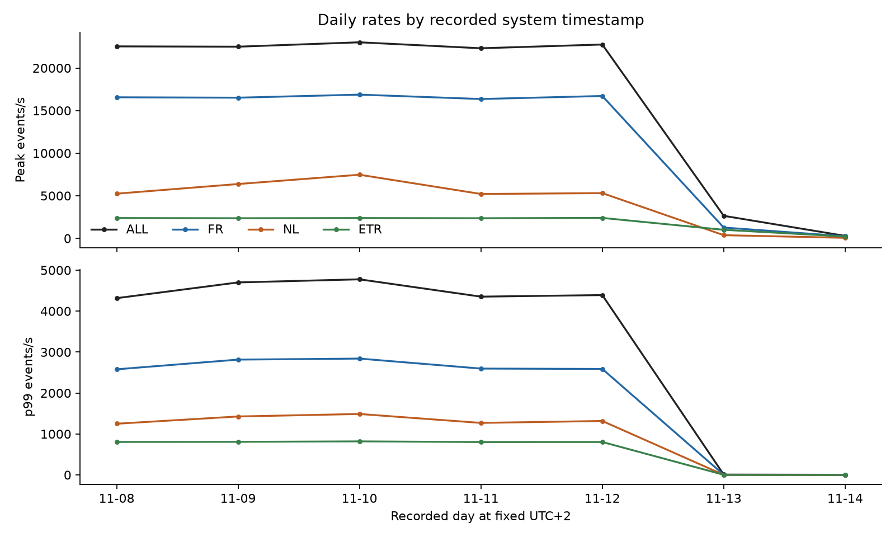
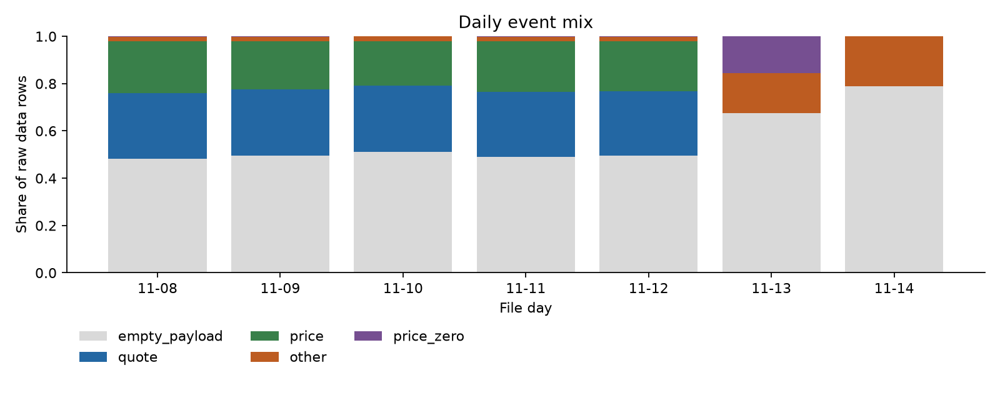
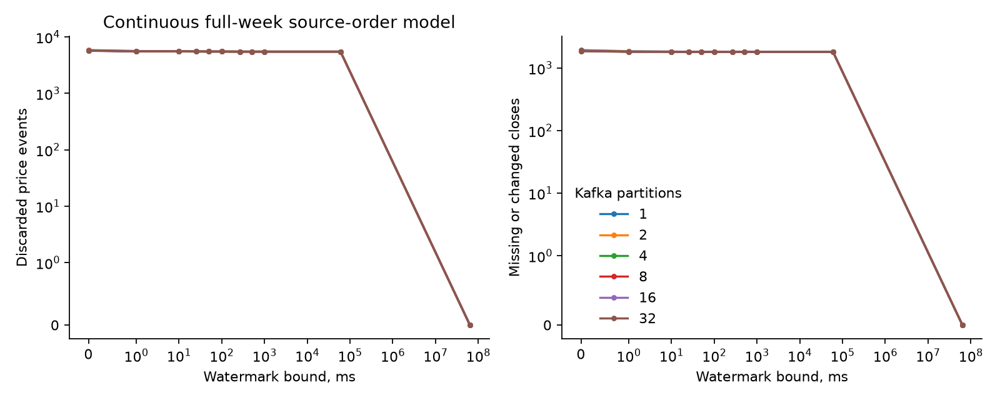

# Full-week dataset analysis

All seven files from 8–14 November 2021 contain 289,116,808 data rows and 59,391,670 accepted price events.
The exact row total reconciles the published rounded figure of 289 million.
Each input's MD5 matches the published checksum, and the seven files total 24,874,180,296 bytes.
This extends the [Monday checkpoint](eda-monday.md) for [issue #4](https://github.com/eemelioksanen/scalable-systems-and-data-management/issues/4).

## Daily checkpoints

| Day | Data rows | Accepted prices | Nonempty windows | p99 rows/s | Peak rows/s |
|---|---:|---:|---:|---:|---:|
| Monday | 53,994,554 | 11,794,520 | 373,126 | 4,317 | 22,537 |
| Tuesday | 58,811,870 | 11,900,121 | 371,307 | 4,701 | 22,500 |
| Wednesday | 64,591,844 | 12,068,273 | 373,987 | 4,777 | 23,016 |
| Thursday | 55,547,846 | 11,835,403 | 368,727 | 4,354 | 22,315 |
| Friday | 56,111,183 | 11,793,353 | 370,310 | 4,392 | 22,756 |
| Saturday | 33,398 | 0 | 0 | 8 | 2,645 |
| Sunday | 26,113 | 0 | 0 | 4 | 290 |

Per-day accepted-price counts and the weekly total of 1,857,457 windows match the recorded oracle evidence.
Monday also has a separate per-day window-count comparison.
Each file also contains 12 comment lines and one header, excluded from the data-row totals.
Both weekend files contain metadata and empty payloads but no accepted prices.
Saturday additionally contains 38 quote rows and 5,179 zero-price rows.
They therefore produce no windows or EMA updates.
The week exercises overnight carry but contains no following Monday with which to measure weekend carry.

These rates use recorded system timestamps, which are not measured ingestion times.
Each daily p99 includes zero-event seconds between the first and last usable timestamp.
The [daily rate tables](../analysis/out/week/daily_rates_summary.csv), [activity spikes](../analysis/out/week/daily_activity_spikes.csv) and daily `arrival_rates` figures retain exchange-level detail.
Wednesday is the busiest day, with a step around 09:00 and late-session spikes around 17:30–17:40 in the recorded clock.

## Population, skew and timestamps

The week contains 143,104,996 empty-payload rows, 80,373,072 quotes, 59,391,670 positive-price rows, 5,930,688 other populated rows and 316,382 zero-price rows.
Only 20.54% of raw replay rows enter price-window processing.
There are no malformed rows, negative prices or malformed prices in these files.
All accepted-price timestamps parse; 54,479,627 require the agreed missing-date fallback, and no valid explicit trading date differs from system Date.
The [quality table](../analysis/out/week/daily_quality.csv) separates these counts by day, exchange and security type.

Rates exclude 67,056 rows with unusable system timestamps, leaving 289,049,752 binned rows.
The combined first-to-last system interval spans 604,238 seconds, with 381,394 empty seconds.
Including that quiet time gives a weekly p99 of 4,216 rows/s, below Wednesday's 4,777.
Use the busiest daily p99 and observed peak as separate replay targets, alongside the weekly p99: 4,777 and 23,016 raw rows/s at 1×, with explicit 10× and 100× stress multipliers.
These are offered-load experiments, not claims about achievable throughput.
See [replay targets](../analysis/out/week/replay_targets.csv).

Of 5,502 observed symbols, 532 have no accepted prices during the entire week.
The top 100 symbols contribute 58.53% of raw rows but 26.90% of accepted prices.
Gini coefficients are 0.8606 and 0.7140 respectively, using all observed symbols, including the zero-price symbols.
The [rank data](../analysis/out/week/symbols.csv), [top-k shares](../analysis/out/week/skew.csv) and each daily `symbol_skew` figure expose this distinction.
With eight Kafka Murmur2 partitions, the busiest partition has 1.2523 times the mean raw load and 1.1616 times the mean price load.
The [partition table](../analysis/out/week/partition_load.csv) includes 1, 2, 4, 8, 16 and 32 partitions.

Across the fixed seven-day calendar there are 11,092,032 possible symbol/windows, of which 9,234,575 are empty, or 83.25%.
All 1,857,457 nonempty windows lie inside that interval, and none receives prices from multiple files.
The denominator includes all 5,502 observed symbols and 2,016 five-minute windows per symbol.
Daily `window_event_histogram.csv` tables retain the price-event density distribution.

Only the Wednesday burst has trading time more than two seconds behind system time, accounting for all 5,506 such prices.
That does not make the clocks interchangeable: the [gap tables](../analysis/out/week/daily_timestamp_gaps.csv) also contain 51,911,359 negative gaps, where system time precedes trading time.
For 4,601 prices the system clock trails trading time by more than two seconds, with a maximum gap of 30,648,607 ms.
Whole-second system timestamps account for 59,386,228 of the 59,391,670 prices, so subsecond clock differences often reflect timestamp precision.
Preserve supplied trading timestamps; do not repair them by substituting system Time.

## Wednesday's 01:00 burst

There are 5,506 accepted index rows at literal trading time `01:00:00.000`, all on Wednesday and received at recorded system time 18:56.
They cover 1,812 symbols: 1,740 have three rows, 71 have four, and one has two.
The [complete row list](../analysis/out/week/index_0100_events.csv) and [group counts](../analysis/out/week/index_0100_groups.csv) preserve physical source lines.

Only 5,492 of these rows have `Last` equal to at least one of `Open`, `Day's high` or `Day's low` on that same row.
The other 14 rows do not match that signature.
The [signature candidate list](../analysis/out/week/summary_candidates.csv) therefore defines a narrower experiment than dropping the entire burst.
This qualifies the issue comment's description of three matching rows per index; it does not change the accepted price policy.
All 5,506 remain in the baseline at their supplied trading time.

## Watermarks and downstream effects

The sufficient all-admitting bound is **64,265,001 ms**, about 17.85 hours of event-time progress, in every tested partition layout.
It preserves every close and therefore every EMA and advisory in the eight-partition comparison.
This is a tested sufficient bound, not a claim that the grid found the smallest bound preserving all closes.
Replay speed determines the corresponding wall-clock delay; the event-time horizon alone does not specify it.

The following scenarios use eight partitions unless stated otherwise.
EMA differences count existing windows where either EMA differs by more than 1e-9; missing windows remain a separate count.

| Scenario | Discarded prices | Missing windows | Changed existing closes | Changed existing EMAs | Advisories removed / added |
|---|---:|---:|---:|---:|---:|
| 0 ms | 5,749 | 1,812 | 70 | 701,976 | 424 / 416 |
| 1 ms | 5,561 | 1,812 | 10 | 686,558 | 424 / 416 |
| 25 ms | 5,528 | 1,812 | 1 | 684,991 | 422 / 416 |
| 264 ms | 5,506 | 1,812 | 0 | 684,661 | 422 / 416 |
| 60 seconds | 5,506 | 1,812 | 0 | 684,661 | 422 / 416 |
| 64,265,001 ms | 0 | 0 | 0 | 0 | 0 / 0 |
| Exclude exact summary signature | 5,492 | 1,798 | 0 | 679,027 | 414 / 408 |

The admit-all baseline emits 11,355 advisories.
The 264 ms and 60-second variants emit 11,349, but that net difference of six hides 422 removed and 416 added advisories.
The 422 removals are 3.72% of baseline advisories; the symmetric set difference is 838.
Their 684,661 changed existing EMA windows are in addition to the 1,812 missing windows.
Dropping only the 5,492 exact-signature rows leaves 14 burst windows and therefore produces a different result.
See the complete [scenario effects](../analysis/out/week/scenario_effects.csv).

The [partition-bound grid](../analysis/out/week/watermark_bounds.csv) includes 1, 2, 4, 8, 16 and 32 Kafka partitions.
With one partition and zero bound, 5,858 prices are late: the 5,506-row burst plus 352 other events.
A 264 ms bound admits those other events in every tested layout.
At smaller bounds, layouts differ: zero bound changes 120 existing closes with one partition and 70 with eight.
At 60 seconds the single-partition and eight-partition results happen to agree on this dataset; the models remain distinct.
The [partition disorder table](../analysis/out/week/partition_disorder.csv) retains backward-pair counts and disorder quantiles, complementing each day's per-symbol table.

Both complete output-hash gates pass after normalizing our fixed UTC+2 timestamps to the oracle evidence's Z offset:

- [Admit-all results and advisories](../analysis/out/week/oracle_crosscheck.json).
- [Single-partition 60-second results and advisories](../analysis/out/week/oracle_bounded_crosscheck.json).

## Decisions and remaining implementation work

Retain all positive prices, including the Wednesday burst, under the accepted timestamp policy.
Use admit-all as the correctness reference and 64,265,001 ms as the demonstrated no-loss source-order comparison.
Treat 264 ms and 60 seconds as explicit faster ablations; neither meets the selected zero-missing-or-changed-close target.
Do not silently adopt the exact-signature exclusion: it changes both output and the price-event definition and does not even remove the whole burst.

Keep the runtime watermark and idleness settings provisional.
[D-28](decisions.md#d-28-query-2-and-subscriptions-2026-09-28-leo-immonen-issue-8) already shows that periodic emission, preload speed and partition idleness affect actual admission.
D-32 has since applied the accepted UTC+2 default. A separate runtime follow-up should verify admission, output and memory with paced input and sparse/resuming partitions.
A short default requires an explicit accuracy trade-off or an accepted change to the price policy; this analysis makes neither change.

## Reproduction and scope

Run `bash analysis/daily.sh YYYY-MM-DD` for each day, followed by `bash analysis/week.sh`.
The [method](../analysis/README.md#continuous-full-week-comparison) explains input checks, ordering, partitioning and the observation interval.
The daily commands use bounded parsing and a network-disabled container capped at 4 GiB.
Daily peak process RSS ranges from 0.33 to 2.79 GiB; weekday analysis takes 104–131 seconds, excluding download verification and image build.
The continuous run took 408.708 seconds and peaked at 4,175,503,360 bytes, or 3.89 GiB process RSS, close to the 4 GiB cap.
It completed under that container limit; this measurement does not promise the same memory margin for larger inputs.
The [week manifest](../analysis/out/week/manifest.json) records the exact sources, checked daily inputs and output hashes.
Raw files and generated local analysis data occupy about 41 GB after completion, below the 60 GB cap.
All ten focused tests pass, and the three weekly figures were visually checked.

This analysis measures the input population, rates, skew, timestamp quality and the consequences of alternative admission policies.
The oracle calculates the expected closes, EMAs and advisories under specified rules.
Here the close aggregation is independent and checked against the oracle's complete output hashes; EMA calculation deliberately reuses the oracle implementation.
It is therefore an independent close-selection check, not a second independent EMA implementation.

No parser or Flink runtime defaults change in this work.
